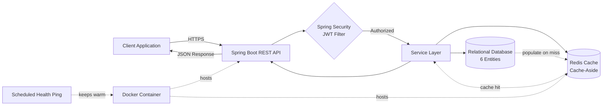
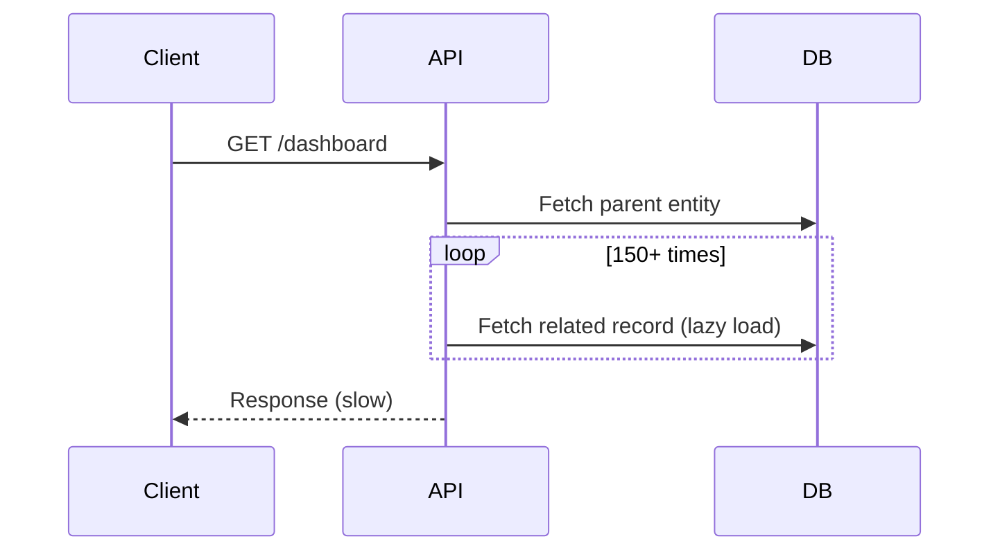
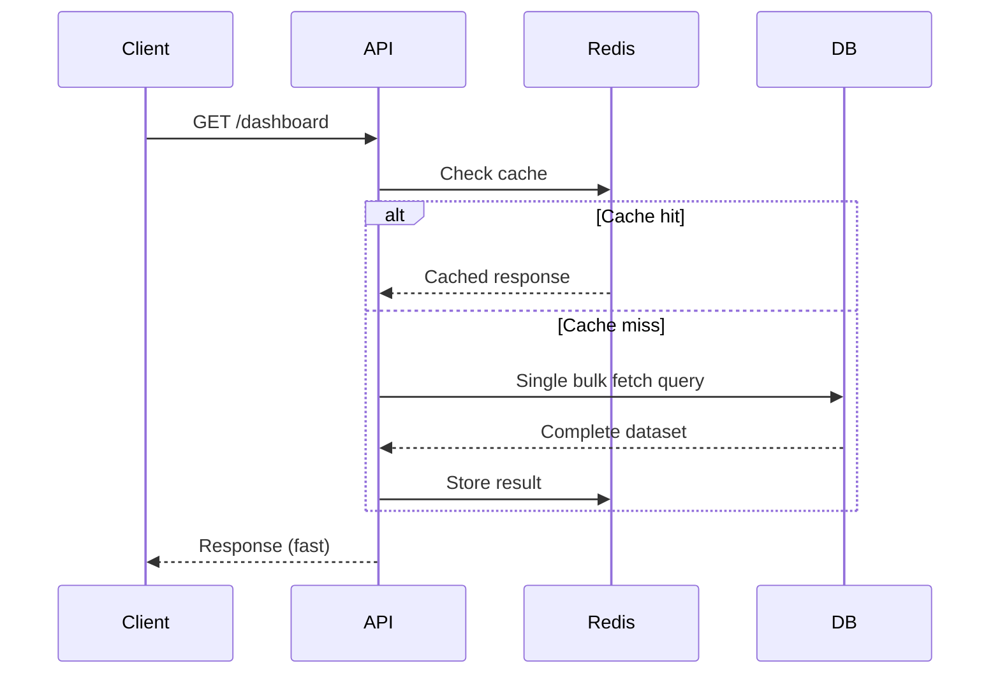

<div align="center">

<p align="center">
  
  
  
  
</p>

<p align="center">
  
  
  
  
  
  
</p>

<p align="center">
  <a href="https://cet-sheet.tech"><b>View Live Application →</b></a>
</p>

<br/>

## Table of Contents

[Overview](#overview) · [System Architecture](#system-architecture) · [Engineering Highlights](#engineering-highlights) · [Query Optimization](#query-optimization) · [Tech Stack](#tech-stack) · [Screenshots](#screenshots) · [Getting Started](#getting-started) · [Project Structure](#project-structure)

<br/>

## Overview

**Master CET Sheet** is a full-stack study platform built for **MHT-CET aspirants** to organize preparation resources and track progress through a single, structured dashboard — replacing scattered spreadsheets, bookmarks, and PDFs.

<table>
<tr>
<td width="33%" valign="top">
<b>Problem</b><br/>
Aspirants juggle resources across disconnected PDFs, sheets, and links with no reliable way to track what has actually been completed.
</td>
<td width="33%" valign="top">
<b>Solution</b><br/>
A centralized, authenticated platform with structured resource tracking and a personal progress dashboard.
</td>
<td width="33%" valign="top">
<b>Engineering Focus</b><br/>
A backend built for low-latency access and predictable performance under real cloud constraints.
</td>
</tr>
</table>

<br/>

## Screenshots

<table>
<tr>
<td width="50%">
</td>
<td width="50%">
</td>
</tr>
<tr>
<td width="50%">
</td>
<td width="50%">
</td>
</tr>
</table>

<p align="center"><i>click image to enlarge</i></p>

<br/>

## System Architecture



<p align="center"><i>Placeholder diagram — will be replaced with the final system design visual.</i></p>

<br/>

## Engineering Highlights

<table>
<tr>
<td width="180" valign="middle"></td>
<td valign="middle">14 REST APIs architected with Spring Boot and Hibernate/JPA over a scalable relational data model of 6 entities, using DTO patterns to decouple internal models from API contracts.</td>
</tr>
<tr>
<td valign="middle"></td>
<td valign="middle">Eliminated N+1 query issues by restructuring Hibernate lazy loading into optimized bulk queries, cutting database roundtrips per request from 150+ down to 2.</td>
</tr>
<tr>
<td valign="middle"></td>
<td valign="middle">Integrated Redis with a Cache-Aside pattern to reduce data retrieval latency, with periodic health pings to mitigate cloud container cold-start delays.</td>
</tr>
<tr>
<td valign="middle"></td>
<td valign="middle">JWT authentication via Spring Security, securing user-specific progress-tracking dashboards.</td>
</tr>
<tr>
<td valign="middle"></td>
<td valign="middle">Containerized the system with Docker, automating deployment pipelines across cloud environments for consistent, scalable delivery.</td>
</tr>
</table>

<br/>

## Query Optimization

<table>
<tr><th>Metric</th><th>Before</th><th>After</th></tr>
<tr><td>DB roundtrips per request</td><td>150+</td><td><b>2</b></td></tr>
<tr><td>Loading strategy</td><td>Per-record lazy loading</td><td>Single bulk fetch query</td></tr>
<tr><td>Data retrieval</td><td>Direct database hit</td><td>Redis Cache-Aside</td></tr>
<tr><td>Cold starts</td><td>Frequent delay on wake</td><td>Mitigated via scheduled health pings</td></tr>
</table>

**Before — N+1 lazy loading**



**After — Bulk fetch with Redis Cache-Aside**



<br/>

## Tech Stack

<p align="center">
  
</p>

<p align="center"><i>Backend: Java, Spring Boot, Spring Security, Hibernate/JPA · Caching: Redis · Auth: JWT · Deployment: Docker<br/>Update the database icon above if your project uses MySQL instead of PostgreSQL. Add frontend framework icons once confirmed.</i></p>

<br/>

## Demo Video

<p align="center">
  
</p>

<p align="center"><i>Demo</i></p>

<br/>

## Getting Started

```bash
git clone https://github.com/ShashwatDiwan/Master-Cet-Sheet.git
cd Master-Cet-Sheet

# Backend
cd backend
./mvnw clean install
./mvnw spring-boot:run

# Frontend (separate terminal)
cd frontend
npm install
npm start
```

Update `application.properties` / `.env` with your database and Redis credentials before running.

**Live:** [cet-sheet.tech](https://cet-sheet.tech)

<br/>

## Project Structure

```
Master-Cet-Sheet/
├── backend/      Spring Boot REST API, JWT auth, Redis cache layer
├── frontend/     Client application
└── README.md
```

<br/>

## Roadmap

- [ ] Add finalized architecture diagram
- [ ] Add real UI screenshots
- [ ] Add embedded demo video
- [ ] Expand automated test coverage
- [ ] Add CI/CD pipeline badge

<br/>

<p align="center">
  <a href="https://github.com/ShashwatDiwan"></a>
</p>

<p align="center">
  
</p>
